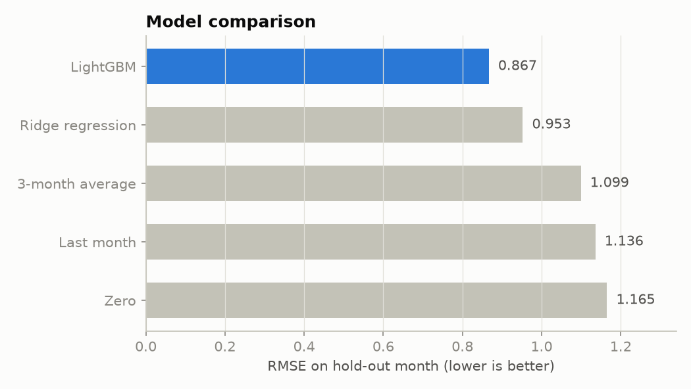
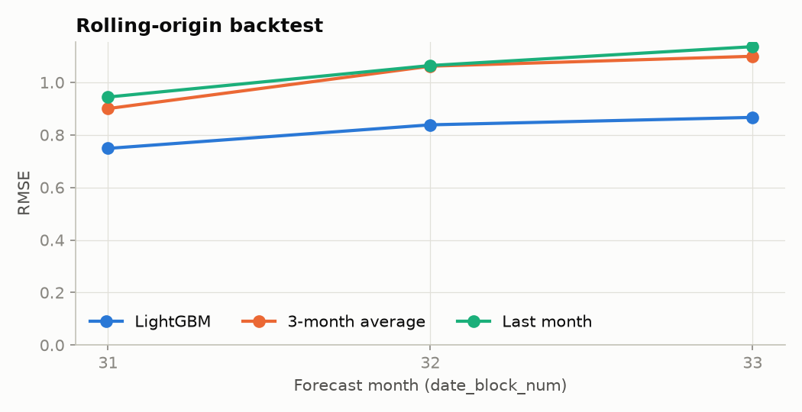
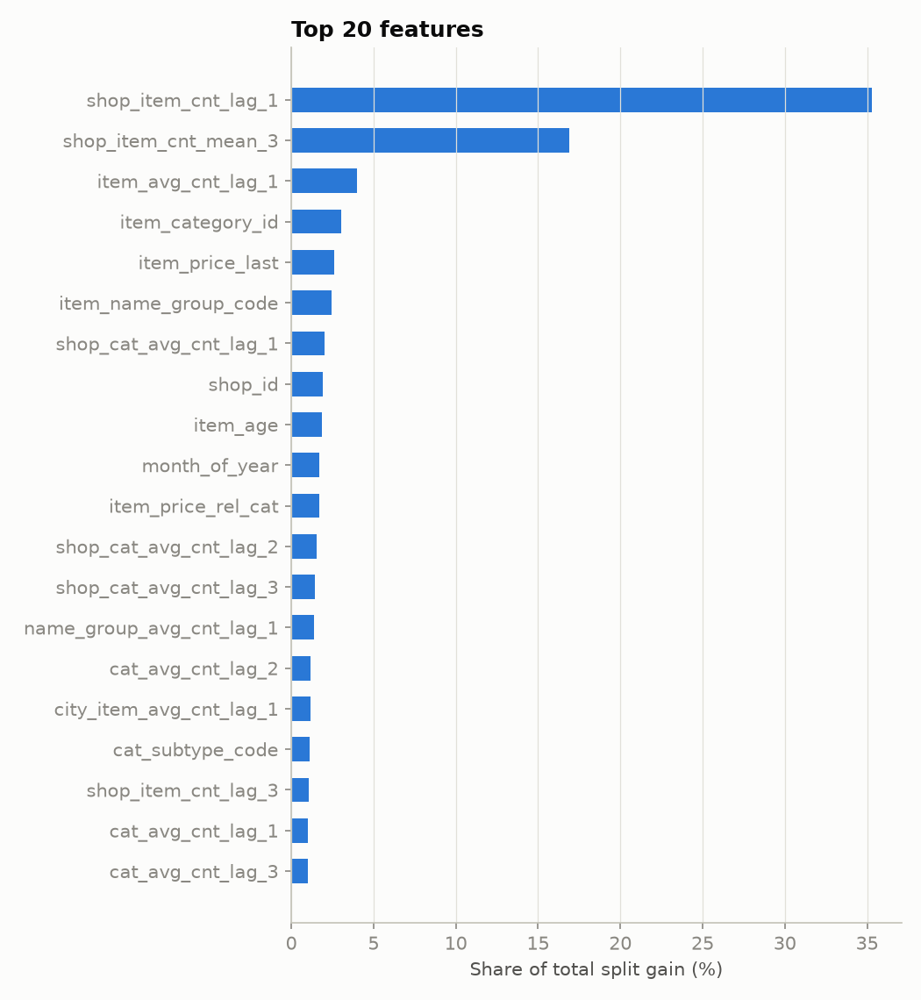
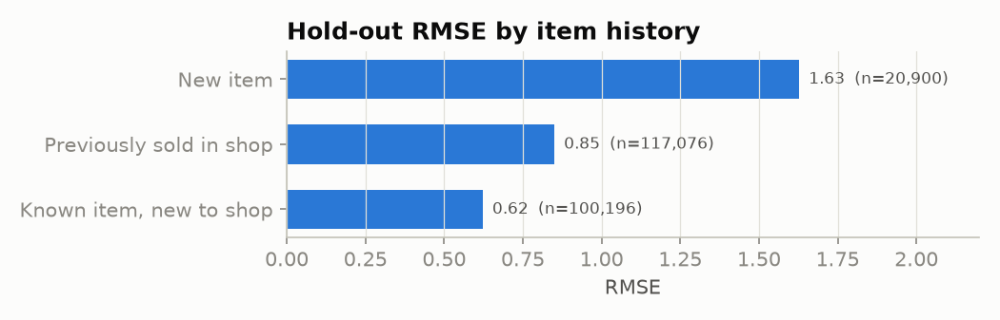
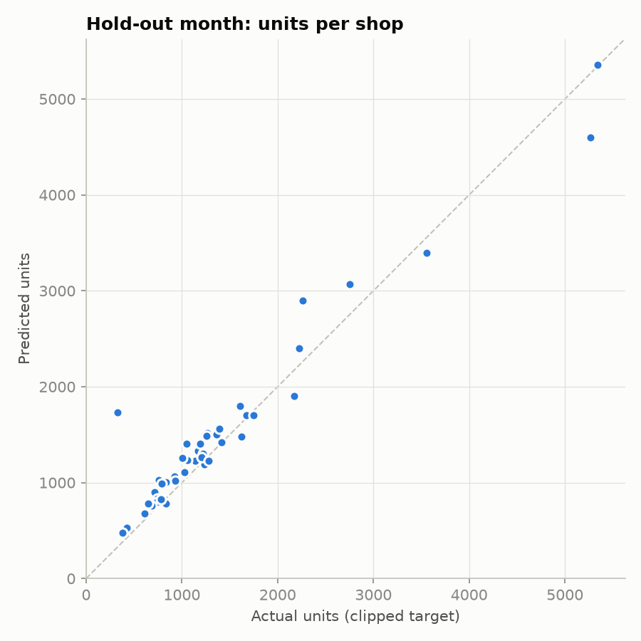
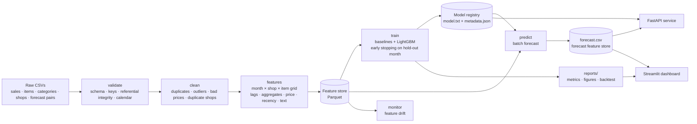

# Multi-store Sales Forecasting

An end-to-end machine-learning system that forecasts **next-month unit sales for every shop × item pair** across a 60-store electronics, games and media retail chain. It uses 2.9M daily transactions (Jan 2013 – Oct 2015) from 1C Company's public retail dataset.

The project covers the whole lifecycle:

**data ingestion → validation → cleaning → feature store → training & evaluation → model registry → batch forecasting → drift monitoring → REST API → dashboard**

It ships with tests, CI and Docker.



## Results

The model is evaluated on a **hold-out month** (October 2015): it is trained on months up to September and scored on October. The target is monthly units per shop/item, clipped to [0, 20].

| Model | RMSE | MAE | R² |
|---|---:|---:|---:|
| Predict zero | 1.165 | 0.259 | −0.05 |
| Last month (naive) | 1.136 | 0.302 | 0.00 |
| 3-month moving average | 1.099 | 0.313 | 0.06 |
| Ridge regression (same features) | 0.953 | 0.362 | 0.30 |
| **LightGBM** | **0.867** | 0.305 | **0.42** |

LightGBM's RMSE is **9% lower than the best baseline** (Ridge) and **21% lower than the 3-month average**.

**Rolling-origin backtest.** For each of the last three months, a model is retrained on all earlier months and scored on that month. LightGBM beats both naive baselines every month:

| Forecast month | LightGBM | 3-month average | Last month |
|---|---:|---:|---:|
| Aug 2015 (31) | 0.749 | 0.900 | 0.944 |
| Sep 2015 (32) | 0.838 | 1.062 | 1.064 |
| Oct 2015 (33) | 0.867 | 1.099 | 1.136 |
| **Mean** | **0.818** | 1.020 | 1.048 |

<p>


</p>
<p>


</p>

### What the evaluation shows

- **Recent history drives the forecast.** A pair's sales last month and its 3-month average account for more than half of the model's split gain. Item-level demand, category, price and item age add the rest.
- **Cold starts are the hardest case.** RMSE on brand-new items is 1.63, about twice the 0.85 for items the shop has sold before.
- **One store accounts for the largest shop-level miss.** On the per-shop scatter, the biggest outlier is a store that opened *in* the hold-out month (shop 36). With no history to go on, the model over-forecasts it, because it falls back on chain-wide priors.
- **The forecast set is built differently from the training data.** Training rows include only items that sold that month, while the forecast set covers every shop × item combination. The drift report flags this: item-level demand features in the forecast month have PSI > 0.5, and the shop revenue trend drops 73%. This needs watching whenever the model is put into production.

## Architecture



| Stage | Command | Output |
|---|---|---|
| Download | `salesforecast download` | `data/raw/*` + SHA-256 `MANIFEST.json` |
| Validate | `salesforecast validate` | `reports/data_validation.json` (fails the run on schema or integrity errors) |
| Features | `salesforecast features` | `data/processed/features.parquet` (6.6M rows × 60 features) + lookup tables |
| Train | `salesforecast train` | `artifacts/models/<run_id>/`, `reports/metrics.json`, `reports/figures/*` |
| Backtest | `salesforecast backtest` | `reports/backtest.json`, `reports/figures/backtest.png` |
| Predict | `salesforecast predict` | `artifacts/predictions/forecast.csv`, `submission.csv` |
| Monitor | `salesforecast monitor` | `reports/drift.json` |
| Everything | `salesforecast all --backtest` | all of the above |

## Approach

### Data validation and cleaning

- **Validation (hard checks):** required columns, nulls, unique keys, referential integrity (every sale points to a known shop and item), the month index matching the calendar date, and no gaps in months.
- **Cleaning (soft findings):**
  - Exact duplicate rows are dropped.
  - Data-entry outliers are removed (a single day with 2,169 units, a price of 307,980).
  - A negative price is imputed from the item's median price.
  - Three shops that appear under two ids (the same address, renamed) are merged, so their history is continuous.
  - Returns (negative quantities) are kept on purpose, because they are real behaviour.

### Feature engineering (`src/salesforecast/features/build.py`)

**The grid.** The training table is a grid: for each month, every shop that sold anything × every item that sold anywhere. This mirrors how the forecast set is built, so the model also learns from zero-sales pairs.

**No leakage.** Every feature for month *t* uses data from months before *t* only. A unit test checks this by tripling October's sales and asserting that no October feature changes.

| Group | Examples |
|---|---|
| Target lags | units for the pair 1, 2, 3, 6 and 12 months ago, 3-month mean, trend |
| Mean-target aggregates (lags 1–3) | by item, shop, category, shop × category, city, city × item, category family, item-name group, chain-wide |
| Price | last observed item price, change vs the item's historical mean, price relative to its category |
| Recency / novelty | item age, months since last sale (item and pair), new-item and new-to-shop flags |
| Shop | city, mall type (ТЦ/ТРЦ/ТРК…), online flag, revenue trend |
| Text | category family and subtype parsed from Russian category names, item-name groups, digital and pre-order flags |
| Calendar | month of year, days in month |

Lags and aggregates are computed on dense `month × key` NumPy arrays rather than through repeated DataFrame merges. The full 11M-row grid builds in about 25 seconds on a laptop.

### Modelling

- **Model:** LightGBM regression with regularised categorical splits (`shop_id`, category ids, city, mall type).
- **Round count:** set by early stopping on the hold-out month.
- **Production model:** retrained on all observed months with that round count.
- **Baselines:** four, trained and scored identically.
- **Tuning:** a small comparison (current params vs categorical regularisation vs no categoricals vs a smaller tree) picked the categorical-regularised configuration in `configs/config.yaml`.

### Model registry and metadata

Each run writes `model.txt` and `metadata.json` to `artifacts/models/<run_id>/`. The metadata records:

- params and best iteration
- feature list
- train, validation and refit months
- every metric
- git SHA and LightGBM version
- the data checksum manifest

`latest.json` points at the production run used by `predict`, the API and the dashboard.

### Monitoring

`salesforecast monitor` compares the forecast month's features with the last observed month:

- **Row-level features:** Population Stability Index, plus the change in missing-value rate.
- **Group-level aggregates** (which take only a handful of values per month): relative change in the mean.

Thresholds live in `configs/config.yaml`.

## Quickstart

Requires Python 3.10+. On macOS, LightGBM also needs OpenMP: `brew install libomp`.

```bash
make setup        # virtualenv + editable install with serve/dashboard/dev extras
make pipeline     # download → validate → features → train → backtest → predict → monitor (~12 min on a laptop)
make serve        # API on http://localhost:8000 (docs at /docs)
make dashboard    # dashboard on http://localhost:8501
make test         # test suite (synthetic data, runs offline in under 10s)
```

The raw data (~16 MB compressed) is downloaded from a public mirror. The source URL is configurable in `configs/config.yaml`. The full pipeline runs on a laptop with 8 GB of RAM.

### Docker

```bash
docker compose --profile pipeline run --rm pipeline   # build features, train, forecast
docker compose up -d api dashboard                    # serve on :8000 and :8501
```

`data/`, `artifacts/` and `reports/` are mounted as volumes, so the containers share one model registry.

## API

| Method | Path | Description |
|---|---|---|
| GET | `/health` | Liveness and whether a model is loaded |
| GET | `/model` | Production model metadata and validation metrics |
| POST | `/predict` | Forecast for a list of `(shop_id, item_id)` pairs |
| GET | `/forecast/shops/{shop_id}?top=20` | The shop's top forecast items |

```bash
curl -X POST localhost:8000/predict -H 'content-type: application/json' \
  -d '{"pairs": [{"shop_id": 5, "item_id": 5037}, {"shop_id": 0, "item_id": 1}]}'
```

```json
{
  "model_run_id": "20261112T163337Z",
  "forecast_month": 34,
  "predictions": [
    {"shop_id": 5, "item_id": 5037, "item_name": "NHL 15 [PS3, русские субтитры]",
     "predicted_units": 0.4612, "in_forecast_set": true},
    {"shop_id": 0, "item_id": 1, "item_name": "!ABBYY FineReader 12 Professional Edition Full [PC, Цифровая версия]",
     "predicted_units": null, "in_forecast_set": false}
  ]
}
```

Predictions are computed live by the registered model from a precomputed feature store for the forecast month. Pairs outside the forecast set return `null` with `in_forecast_set: false` instead of a made-up number.

## Dashboard

`app/dashboard.py` (Streamlit + Plotly) has three tabs:

- **Overview:** monthly unit sales, top shops by revenue, units by category family.
- **Model performance:** hold-out metrics, model comparison, feature importance, error by category, backtest, drift tables.
- **Forecast explorer:** pick a shop to see its top forecast items, and pick an item to see its monthly history alongside the forecast.

## Project structure

```
├── app/dashboard.py              Streamlit dashboard
├── configs/config.yaml           paths, cleaning rules, features, model params, monitoring thresholds
├── src/salesforecast/
│   ├── data/                     ingest (download + checksums), validate, clean
│   ├── features/                 text parsing, grid + feature builder, Parquet feature store
│   ├── models/                   baselines, train/backtest, evaluate (metrics + figures), registry, predict
│   ├── monitoring/drift.py       PSI and mean-shift drift report
│   ├── serving/                  FastAPI app + pydantic schemas
│   ├── pipeline.py               stage orchestration
│   └── cli.py                    `salesforecast <stage>`
├── tests/                        synthetic-data fixtures; unit, leakage, end-to-end and API tests
├── reports/                      metrics, backtest, drift and validation JSON + figures from the latest run
├── Dockerfile, docker-compose.yml, Makefile
└── .github/workflows/ci.yml      lint + tests on Python 3.11/3.12, Docker build
```

## Testing and CI

The tests generate a small synthetic dataset with the real schema, so they run in under 10 seconds with no download. They cover:

- **Validation:** rejects unknown ids, calendar mismatches and missing columns.
- **Cleaning:** duplicates, outliers, bad prices and shop merges.
- **Feature correctness:** the target equals the clipped monthly sum, and lag 1 equals the previous month's target.
- **No leakage:** changing month *t*'s sales leaves month *t*'s features unchanged.
- **Cold-start flags:** items that never sold are flagged as new.
- **End to end:** the full pipeline, from validation through monitoring, produces a registered model, reports and a complete forecast.
- **API:** batch and online predictions agree, unknown pairs return null, unknown shops return 404, empty requests return 422.

GitHub Actions runs `ruff` and `pytest` on Python 3.11 and 3.12, then builds the Docker image.

## Limitations and next steps

- **Cold starts:** new items and newly opened shops have the largest errors. Item-name text embeddings, or borrowing history from similar items, would help most.
- **Grid mismatch:** training rows come from items that sold, while forecast rows cover every pair. Sampling extra non-selling pairs into training would close this gap.
- **Uncertainty:** forecasts are point estimates. Quantile objectives would give stock-planning intervals.
- **Retraining:** retraining is manual. The drift report is designed to be the trigger in a scheduled job.

## License

Released under the [Apache License 2.0](LICENSE).
